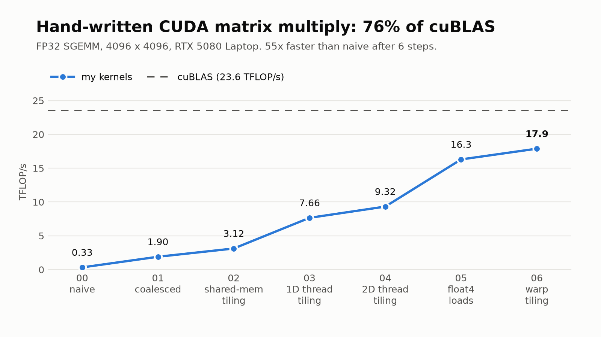
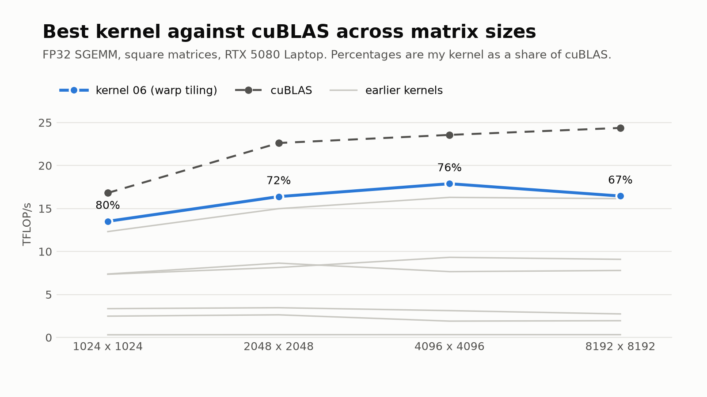
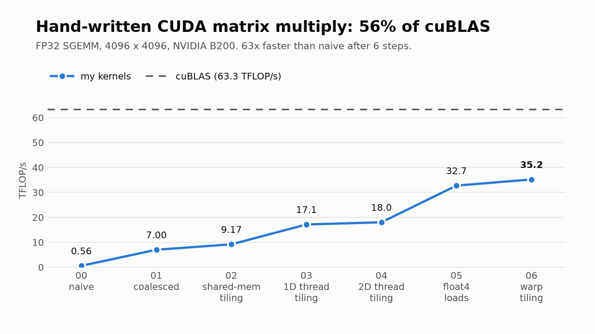
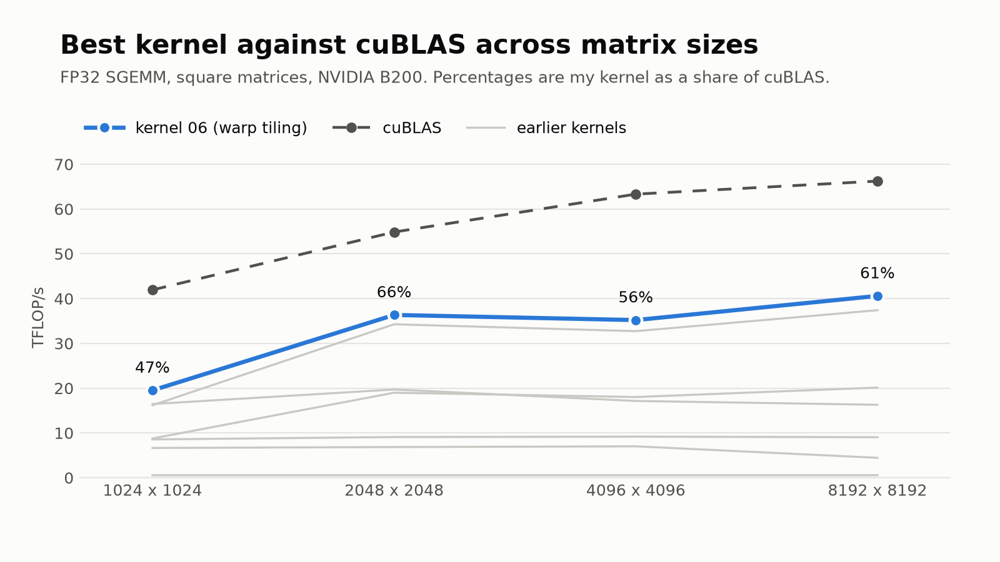

# blackwell-gemm

Matrix multiplication (FP32 SGEMM) written from scratch in CUDA, optimized one step at a time and measured against cuBLAS on an RTX 5080 Laptop GPU and an NVIDIA B200.

## Kernels

| # | Kernel | What changed |
|---|---|---|
| 00 | Naive | One thread per output element, reading straight from global memory. |
| 01 | Coalesced | Neighboring threads read neighboring memory, so loads get batched. |
| 02 | Shared-memory tiling | Each block copies a tile of A and B into shared memory and reuses it. |
| 03 | 1D thread tiling | Each thread computes 8 outputs instead of 1 and keeps its sums in registers. |
| 04 | 2D thread tiling | Each thread computes an 8x8 patch, reusing every loaded value 8 times. |
| 05 | float4 loads | Loads four floats at a time and stores A transposed so shared-memory reads are vectorized too. |
| 06 | Warp tiling | Splits each block's tile between warps, then between the threads of each warp. This was the hardest one. |

Code is in `src/kernels/`, one file per kernel.

### RTX 5080 Laptop

FP32 SGEMM. Left: every kernel at 4096 x 4096. Right: the best kernel across matrix sizes. The dashed line is cuBLAS on the same GPU.

The GPU the kernels were written and tuned on.

 

### NVIDIA B200

The same code, with no retuning, on a rented B200.

 


## Run it

Needs an NVIDIA GPU, the CUDA toolkit and CMake.

```bash
cmake -S . -B build && cmake --build build -j
./build/gemm              # every kernel, every size
./build/gemm 6            # one kernel
```

Every kernel is checked against cuBLAS before it is timed.


## Profiling

Each kernel was profiled with Nsight Compute at 4096 x 4096, and the full run was traced with Nsight Systems. The report files are attached to the [latest release](https://github.com/VrajPatel105/blackwell-gemm/releases/latest) and open in the Nsight Compute and Nsight Systems UIs.

To reproduce everything on your own GPU (build, benchmark, plots, profiles):

```bash
scripts/run_all.sh mygpu "My GPU name" <cuda_arch>
```